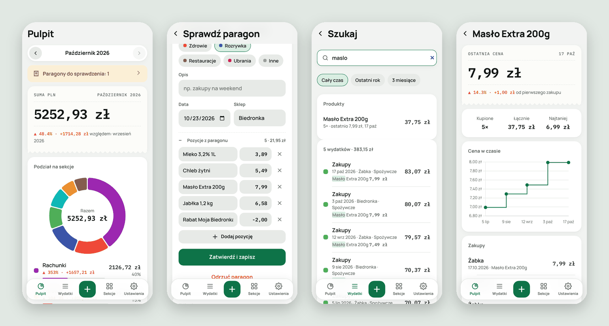

# PixBill

[](https://github.com/alekrisownik-dot/PixBill/actions/workflows/tests.yml)

Domowa aplikacja do zliczania miesięcznych wydatków ze zdjęć paragonów i ręcznych wpisów.
Działa na własnym serwerze, paragony odczytuje lokalny model w Ollamie, a dostęp jest wyłącznie przez Tailscale.

<picture>
  <source media="(prefers-color-scheme: dark)" srcset="docs/screenshots/hero-dark.png">
  
</picture>

## Co potrafi

- **Paragon ze zdjęcia.** Robisz zdjęcie, a model odczytuje sklep, datę, sumę i pozycje. Przed zapisaniem sprawdzasz i poprawiasz dane.
- **Pozycje i ceny produktów.** Widać, ile wydajesz na konkretne produkty i jak zmieniała się ich cena między zakupami.
- **Wykresy i porównania.** Podział miesiąca na sekcje, zmiana względem poprzedniego miesiąca i trend z ostatnich 12 miesięcy.
- **Własne sekcje i opłaty stałe.** Czynsz albo internet dodajesz raz, a aplikacja co miesiąc sama dopisuje je do wydatków.
- **Budżety.** Limit na sekcję z paskiem postępu i ostrzeżeniem przy 80% i 100%.
- **Kalendarz wydatków.** Siatka dni miesiąca pokazuje, kiedy wydajesz najwięcej.
- **Podsumowanie miesiąca.** Suma, porównanie, największy wydatek oraz produkty, które podrożały i potaniały.
- **Paragony z kaucją.** Ich zdjęcia nie kasują się same, dopóki ich nie usuniesz.
- **Wykrywanie duplikatów.** Ostrzega, gdy ten sam paragon trafi drugi raz.
- **Wyszukiwarka.** Szuka w sklepach, opisach i produktach ze wszystkich miesięcy, także bez polskich znaków.
- **Eksport do Excela.** Plik .xlsx z dwoma arkuszami: wydatki i pozycje z paragonów.
- **Działa bez połączenia.** Wydatki i zdjęcia zapisane offline wysyłają się same, gdy telefon znów połączy się z serwerem.
- **Prywatność.** Wszystko zostaje na Twoim serwerze. Zdjęcie paragonu jest kasowane 10 dni po zatwierdzeniu, a dane zostają w bazie.

## Aplikacja na telefon

Interfejs to PWA serwowane przez backend pod adresem z `tailscale serve`
(np. `https://<laptop>.<tailnet>.ts.net`). Otwierasz go na telefonie z włączonym Tailscale i instalujesz:

- Android (Chrome): menu ⋮ → „Zainstaluj aplikację”,
- iPhone (Safari): Udostępnij → „Do ekranu początkowego”.

Ma tryb jasny i ciemny, który dobiera się do ustawień telefonu.

## Backend

- `docker-compose.yml`: aplikacja (FastAPI) i Ollama z dostępem do GPU.
- Baza SQLite w `data/pixbill.db`, zdjęcia w `data/photos/`.
- API:
  - logowanie hasłem (`POST /api/login`)
  - sekcje: lista, dodawanie, edycja, archiwizacja (`/api/categories`)
  - wydatki: ręczne dodawanie z opisem i sekcją, filtrowanie po miesiącu i sekcji (`/api/expenses`)
  - paragony: wgranie zdjęcia, odczyt w tle przez Ollamę, ekran weryfikacji i zatwierdzenie (`/api/receipts`)
  - statystyki: suma miesiąca, podział na sekcje, porównanie z poprzednim miesiącem, trend (`/api/stats`)
  - wyszukiwanie wydatków (`/api/expenses/search`)
  - produkty z paragonów i historia cen (`/api/products`)
  - opłaty stałe (`/api/recurring`)
  - eksport do Excela (`/api/export/xlsx`)
- Zdjęcie paragonu jest kasowane 10 dni po zatwierdzeniu. Dane zostają w bazie.
- Dokumentacja API po uruchomieniu: `http://127.0.0.1:8000/docs`.

## Instalacja

Zobacz [docs/INSTALL.md](docs/INSTALL.md).

## Praca lokalna i testy

```bash
cd backend
python -m venv .venv && . .venv/bin/activate
pip install -r requirements-dev.txt
pytest
PIXBILL_DATA_DIR=../data uvicorn app.main:app --reload
```

## Ustawienia (`.env`)

| Zmienna | Domyślnie | Opis |
|---|---|---|
| `PIXBILL_PASSWORD` | `zmien-mnie` | Hasło do aplikacji |
| `PIXBILL_SECRET_KEY` | | Sekret sesji; gdy pusty, aplikacja sama tworzy losowy w `data/secret_key` |
| `PIXBILL_OLLAMA_MODEL` | `qwen2.5vl:3b` | Model do odczytu paragonów, np. `gemma3:4b` |
| `PIXBILL_PHOTO_RETENTION_DAYS` | `10` | Po ilu dniach od zatwierdzenia kasować zdjęcie |
